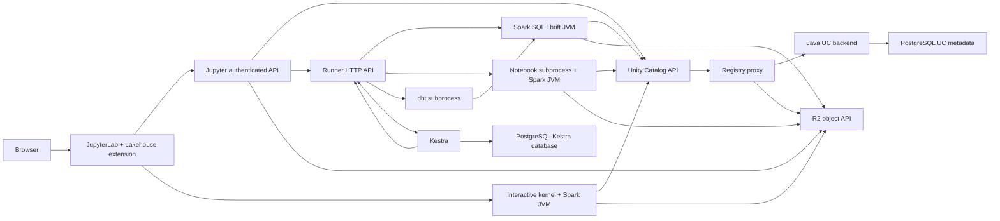
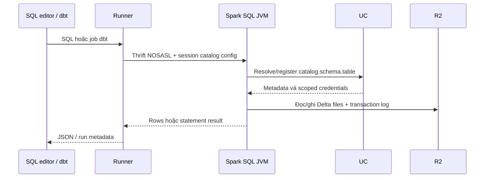

# Kiến trúc và luồng xử lý

Kiến trúc áp dụng cho các service trong Compose. Xem [VERSIONS.md](VERSIONS.md) cho dependency và [HANDOVER.md](HANDOVER.md) cho mục tiêu/ràng buộc.

## Một host, nhiều service

SQL/dbt không chạy trong kernel notebook đang mở. `SPARK_THREADS` là local parallelism trong từng Spark JVM, không cấp worker từ host khác. `POOL(max_workers=2)` của runner không có nghĩa hai job I/O cùng chạy: `LOCK` tuần tự hóa execute và SQL gateway. Kernel tương tác có thể hoạt động ngoài lock.

| Service | Khởi động/tiến trình | Trách nhiệm |
|---|---|---|
| postgres | PostgreSQL 16.6 | Database unitycatalog và kestra trong cùng postgres_data |
| catalog | UC server + R2CredentialGenerator | Metadata UC, managed table support, credential vending |
| registry | registry_service.py + catalog_registry.py | Proxy UC, conditional JSON registry trên R2, sync/replay/health barrier |
| runtime-init | migrate_runtime.py, one-shot, root | Chuyển artifact cũ có so hash, chuẩn hóa ownership runtime volume |
| bootstrap | bootstrap.py, one-shot, analyst | Đảm bảo R2 prefixes, catalog/schema/incoming volume, sample nếu thiếu |
| notebook | start.sh notebook → JupyterLab | UI extension, API gateway và kernels |
| sql | start.sh sql → sql_supervisor.py → Spark Thrift | SQL shared endpoint, watchdog/restart control |
| runner | runner.py / FastAPI | Job subprocess, structured history, workflow logic, retention |
| kestra | standalone, image pin digest | Schedule, persisted executions và HTTP tasks gọi runner |
| backup | Profile tools, root | Đóng gói/tải snapshot; không chạy thường trực |

## Trình tự khởi động

`scripts/start.sh` kiểm tra Docker/R2 placeholders/disk, build image, chạy one-off root chown workspace/ivy/SSH. Script force-recreate bootstrap để việc tạo prefix vẫn được chạy lại dù image không đổi.

Trong dependency graph: postgres healthy → catalog healthy; runtime-init hoàn tất + catalog healthy → registry kiểm/replay R2 và healthy → bootstrap; bootstrap hoàn tất → notebook và sql; sql healthy → runner; runner healthy + postgres healthy → kestra. Bootstrap/runtime-init Exited (0) là thành công. Health SQL chạy SELECT 1; health catalog kiểm tra API metadata. Kestra chưa khai báo healthcheck trong Compose; cần kiểm tra UI/login/execution riêng.

`docker compose up` trực tiếp không nhất thiết lặp lại bootstrap one-shot đã hoàn tất; dùng script start/rebuild khi cần khởi tạo lại prefix. `rebuild.sh --reset-metadata` kiểm tra R2 trước rồi xóa đúng bốn metadata volumes thuộc project; xem [REBUILD_DBT.md](REBUILD_DBT.md).

## Notebook tương tác và notebook nền

Interactive: Jupyter kernel → IPython startup `00-lakehouse.py` → `spark_session.create_spark()` → cấu hình Delta/UC/Maven → có biến spark và magic %%sql. Từng kernel giữ biến và SparkContext riêng; đóng tab chưa shutdown kernel. HTML result được giới hạn 1000 dòng khi dùng magic.

Background: API POST jobs → runner cấp Run ID → chụp code → execute_notebook.py/NBClient mở kernel riêng trong runner container. Parameters được đưa vào biến `parameters`; `set_output()` ghi JSON output qua run context. Cell status/stdout/error/output notebook được lưu trong run artifact, không ghi đè notebook nguồn. Source snapshot dùng cho quan sát; notebook thực thi dùng bản copy source.ipynb, còn working directory và file phụ vẫn trỏ workspace tại thời điểm chạy.

## SQL, dbt và UC/R2

dbt subprocess dùng dbt-spark method thrift; runner sinh profiles.yml với threads=1 và session parameters đăng ký UC catalogs. Tác vụ SQL thực thi trong SQL service. Artifact dbt target/log nằm theo từng run, không nằm cạnh model trong workspace. `dbt docs generate` tạo snapshot; Open Docs phục vụ asset qua Jupyter auth cùng port.

Để đảm bảo format khi tạo bảng, dùng `USING DELTA`. Nếu bỏ USING, cần đặt `spark.sql.sources.default=delta` trong Compute Extra Spark config. `spark.sql.defaultCatalog` quyết định namespace mặc định; không dùng temporary view thay metadata UC. Vị trí object thực tế lấy từ metadata table, không suy ra rằng mỗi catalog/schema luôn tương ứng một folder có tên giống vậy.

### Tích hợp credential R2 tùy biến

`catalog/R2CredentialGenerator.java` được biên dịch vào UC image và đăng ký trong server.properties. Nó kiểm tra bucket/location từ CredentialContext, ký JWT với prefix/object scope, trả credentials có thời hạn 3600 giây và scope read-only hoặc read-write theo privilege yêu cầu. ARN trong cấu hình là sentinel để parser UC chấp nhận; không có AWS IAM role thật được assume.

Đây là integration riêng cần regression khi nâng UC/R2 connector. Scoped credential không thay per-user authorization: UC auth đang disabled, và notebook/runner còn có parent R2 credential trong environment. Xem [SECURITY.md](SECURITY.md).

## Portable UC registry

Toàn bộ client project dùng UC_URL registry proxy, backend catalog không publish host port. POST/PATCH/PUT/DELETE metadata catalogs/schemas/tables/volumes được serialize và sync trước response thành công. Reconcile scan có pagination bắt cả empty namespace và thay đổi ngoài proxy trong khoảng poll. R2 current.json có version/bucket/ETag CAS; runtime/registry/state.json giữ lineage, pending/restore marker và unsupported inventory.

Registry replay khi UC trống diễn ra trước bootstrap. UC nonempty khác registry không có lineage khớp bị chặn. Partial replay resume không ghi đè object có định nghĩa khác. Managed asset không bị biến thành external; bảng/volume chưa replay vẫn giữ inventory và có cảnh báo Compute. Chi tiết và giới hạn ở [CATALOG_REGISTRY](CATALOG_REGISTRY.md).

## GitHub onboarding và native Git

GitHub panel gọi git_integration.py qua authenticated Jupyter gateway. Init/connect lưu Git author, origin SSH và core.sshCommand theo repo; clone giữ default branch/history/upstream. Cả hai tự merge managed `.gitignore`. Commit đầu chỉ stage file đã review; native Git dùng cùng `.git` sau đó.

Entrypoint notebook khởi động agent tại `$HOME/.ssh/lakehouse-agent.sock` và export SSH_AUTH_SOCK trước exec Jupyter. git_askpass.py chỉ cấp passphrase cho child process; key ở git_ssh, passphrase không persist. Hub dùng start_singleuser.py để mỗi user có agent trong home riêng. Native Git subprocess kế thừa socket nên không cần hỏi passphrase từng push; encrypted key cần Unlock sau agent restart. SSH command pin GitHub Ed25519 host key và giữ StrictHostKeyChecking. Xem [Git workflow](GITHUB_WORKSPACE.md).

## Workflow execution

DAG đơn giản được `workflows.compile_flow()` biên dịch thành Kestra Dag với HTTP Request cho từng task. Node có input/variables, condition/loop/parent, runWhen khác success hoặc biểu thức template đi qua một HTTP task tổng; `workflow_runtime.py` thực thi graph bên trong runner.

Ở chế độ logic, loop tuần tự, biến mỗi iteration được copy riêng; output lưu theo task và iteration. Dependency chỉ nối sibling trong cùng branch. Tối đa 100 node, 5 cấp nested blocks, maxIterations 1..1000, tổng budget 10000 lượt task, output task/loop tối đa 10 MiB theo code. Flow timeout tối đa 86400 giây; giới hạn không biến retry thành exactly-once. Dừng execution ở Kestra chưa bảo đảm process runner dừng tức thì.

Flow JSON/YAML lưu trong workspace. Kestra lưu revision đã publish trong PostgreSQL; runner lưu trace nâng cao và liên kết Run ID. Sửa JSON không tự sửa revision đang publish: Save & publish trước khi chạy. Sample chỉ được tạo, không tự publish/chạy ở bootstrap.

## Trạng thái, restart và tính bền vững

Run thông thường: QUEUED → RUNNING → SUCCESS / FAILED / TIMED_OUT; restart runner đánh dấu job còn dở INTERRUPTED, không tự replay. Kestra có state riêng; history đồng bộ trạng thái tổng và ghép local traces/runs. History SQLite dùng WAL, khóa chính (category,id); file run.json và artifacts vẫn là phần dữ liệu cần giữ.

Compute lưu `.lakehouse/spark.json` chung. SQL restart đợi LOCK, ghi request ID vào runtime/sql-control, supervisor restart JVM và báo READY/FAILED. Kernel được chọn restart tuần tự. Restart kernel làm mất biến trong RAM. Config có hiệu lực cho session mới; kernel không được chọn có thể còn config cũ.

## Dữ liệu nào ở đâu?

| Nguồn bền vững | Nội dung | Nếu mất |
|---|---|---|
| Git source | Application/scripts/docs/templates | Có thể clone lại; không có user data |
| WORKSPACE_DIR bind mount | Notebook/dbt/workflows, Spark settings, Git riêng | Mất code chưa backup/commit và config đã lưu |
| postgres_data | UC + Kestra metadata | R2 files không tự dựng lại đầy đủ catalog/executions |
| lakehouse_data | Run artifacts, SQLite history, workflow traces, upload sessions, Spark local temp/metastore | Mất lịch sử/output và khả năng resume upload từ session local |
| git_ssh | Key Git của analyst | Phải khôi phục riêng hoặc tạo key mới |
| spark_ivy / spark_ivy_sql | Maven cache | Tải lại dependency; không phải table data |
| kestra_storage / kestra_tmp | File và temp Kestra | Cần snapshot phù hợp để restore executions |
| R2 warehouse | Delta data và _delta_log | Metadata PostgreSQL không phục hồi được dữ liệu đã xóa |
| R2 incoming | Object upload | Chưa tự trở thành table Delta |
| R2 UC_REGISTRY_PREFIX | Định nghĩa catalog/schema/external assets và inventory managed | Có thể mất khả năng replay nếu mất registry và PostgreSQL |
| R2 BACKUP_PREFIX | Snapshot local state | Không chứa bản nhân đôi toàn bộ warehouse |

Local `spark-warehouse`/Derby phụ được chuyển sang runtime volume cho session nội bộ; không phải database UC chính. Không xóa chỉ vì tên giống thư mục tạm: có thể còn local tables cũ. Runtime-init chỉ archive legacy Hive khi có marker quản trị sau kiểm tra.
