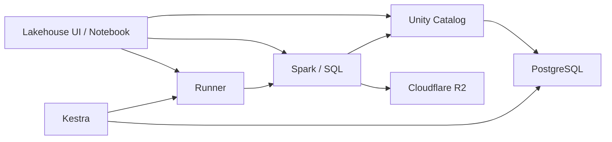
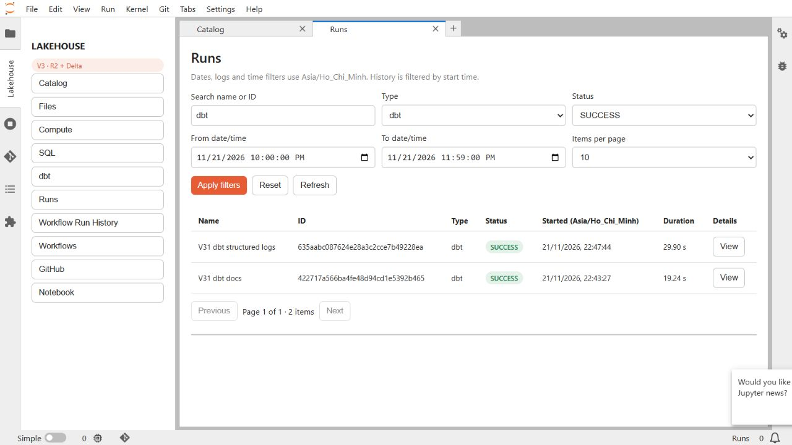
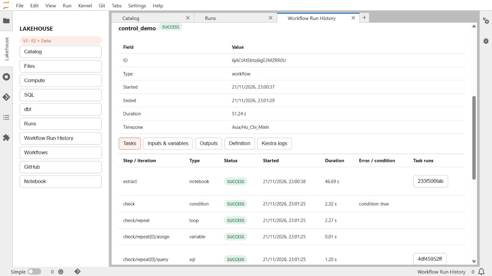

# Tính năng và kiến trúc

## Các thành phần

| Thành phần | Vai trò | Lưu trữ chính |
|---|---|---|
| Notebook | JupyterLab + extension Lakehouse; notebook Python/Spark, SQL cell | Code trong workspace |
| Spark SQL | Spark Thrift/HiveServer2 cho SQL editor, dbt, ODBC | Đọc/ghi Delta trên R2 |
| Runner | Chạy notebook/dbt/SQL nền, điều phối logic workflow | Run artifact và history trong lakehouse_data |
| Unity Catalog OSS | Quản lý catalog/schema/table/volume | PostgreSQL |
| PostgreSQL | Database cho UC và Kestra | postgres_data |
| Kestra | Schedule, execution và điều phối workflow | PostgreSQL, kestra_storage, kestra_tmp |
| R2 | Dữ liệu Delta đang hoạt động, file incoming, snapshot backup | Bucket của bạn |

## Giao diện

- Các mục Catalog, Files, Compute, SQL, dbt, Runs, Workflows, Workflow Run History, GitHub và Notebook mở thành tab trong vùng chính. Tab mới được chọn ngay; đóng/mở lại giữ nội dung đang nhập trong phiên trình duyệt.
- **Catalog:** tạo catalog/schema, liệt kê table/volume, xem columns/location, preview và mở truy vấn thành notebook. SQL mặc định dùng catalog/schema do bạn cấu hình; bảng mới qua UC connector được đăng ký vào UC.
- **Files:** cây thư mục R2; tải file, upload nhiều file dưới incoming/, progress theo part, hủy và tiếp tục upload cùng file. Phần dữ liệu bảng warehouse/ chỉ đọc qua file browser này.
- **Compute:** status, CPU threads, memory, shuffle, default catalog/schema, Spark config và Save & Restart Spark cho SQL/dbt, kernel được chọn hoặc cả hai.
- **Notebook/SQL:** Spark và %%sql được nạp khi kernel khởi động; kết quả truy vấn hiển thị dạng bảng. SQL editor và preview giới hạn 1000 dòng.
- **GitHub:** Git panel cho clone/branch/diff/commit/pull/push; SSH key ở volume riêng.
- **dbt:** debug/deps/seed/build/test/snapshot/docs; chọn project, selection, catalog/schema. Open Docs mở bộ tài liệu được sinh từ run.
- **Runs:** tìm name/ID, type/status/from–to, paging/page size. Detail có Code, Logs, Models/Cells, Parameters, Outputs, Artifacts.
- **Workflow:** bố trí node bằng kéo thả, dependency, Variables, If/Else, For each, Success/Failure/Always, input/output, retry và cron/timezone. Workflow Run History xem từng iteration và log run con.
- **Vận hành:** TZ thống nhất, retention artifact/history, preview cleanup; run gián đoạn được đánh dấu INTERRUPTED sau khi runner khởi động lại.

Ảnh minh họa được chụp trong đợt kiểm thử 21/11/2026. Một số tên run trong ảnh thuộc các ví dụ đã được dọn khỏi workspace; lịch sử vẫn được giữ theo retention.

## Giới hạn cần hiểu

- Đây là project tự host, không phải Databricks Runtime hay bản sao đầy đủ Databricks Cloud.
- Compute hiện là Spark local trong từng JVM/container. Notebook kernel, SQL service và notebook job nền có ngân sách RAM riêng; chưa có cluster phân tán hoặc autoscaling.
- UC authorization hiện tắt; mọi người có thể chạy code thuộc cùng miền tin cậy. JupyterHub không tự tạo quyền bảng/file riêng, row-level security hay column masking. Permissions UI hiển thị đúng giới hạn này.
- Metadata UC đang hoạt động ở PostgreSQL. R2 chứa Delta và bản backup metadata; file _delta_log không thay database catalog.
- DAG đơn giản có task tương ứng trong Kestra. Flow có logic dùng runner điều phối; xem từng bước/iteration trong Workflow Run History. Kestra giữ schedule và trạng thái tổng. Dừng execution Kestra chưa bảo đảm dừng tức thời request đang chạy trong runner.
- Runner tuần tự hóa các task I/O qua một lock; notebook tương tác vẫn có thể ghi. Quản lý việc ghi cùng bảng khi làm việc đồng thời.
- Upload cập nhật progress theo part 32 MiB; mỗi file được xử lý tuần tự. Chưa kiểm chứng upload 300 GB trong một lần.
- Đổi TZ không viết lại các timestamp cũ hoặc timezone đã cấu hình riêng cho schedule.
- Power BI/ADF cần driver/kết nối riêng; xem [EXTERNAL_CLIENTS.md](EXTERNAL_CLIENTS.md). Multiuser là tùy chọn, xem [MULTIUSER.md](MULTIUSER.md).

Các giới hạn cụ thể và kết quả kiểm thử nằm trong [VALIDATION.md](VALIDATION.md).
