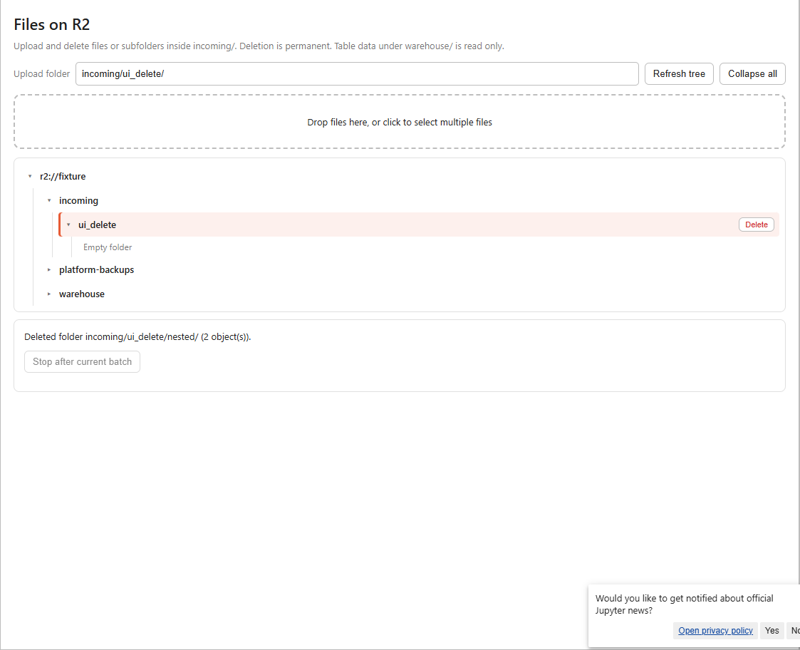
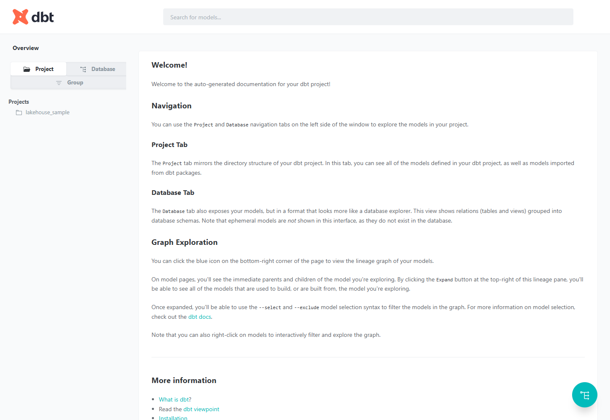

# Sử dụng workspace

## Notebook và SQL

Từ File Browser, bấm nút tạo mới/Launcher → Python 3 notebook; lưu bằng tên và đường dẫn của bạn, ví dụ `notebooks/etl.ipynb`. Chờ kernel khởi động và thông báo Spark ready. Trong Python đã có `spark`; trong SQL cell dùng:

```sql
%%sql
SELECT current_catalog(), current_schema(), current_timezone();
```

Trong panel **SQL**, nhập SQL trực tiếp. Ví dụ tạo bảng của bạn:

```sql
CREATE TABLE IF NOT EXISTS customer_events USING DELTA AS
SELECT 1 AS id, current_timestamp() AS created_at;
```

Lệnh này tạo bảng thật và ghi dữ liệu trên storage theo catalog/schema đang dùng. Đổi tên bảng trước khi sử dụng cho công việc của bạn. Dùng tên đầy đủ `catalog.schema.table` để chỉ rõ nơi đọc/ghi. SQL cell và preview giới hạn 1000 dòng để hiển thị.

Để chạy notebook đã lưu ở background, mở **Notebook**, điền đường dẫn tương đối từ workspace và Parameters JSON, rồi Run in background. Theo dõi trong **Runs**; output được lưu riêng. Không cần chèn lại cấu hình Spark/Maven trong từng notebook.

Notebook chạy trong workflow nhận `parameters` và helper:

```python
batch = parameters.get("batch", "daily")
set_output("batch", batch)
set_output("count", 10)
```

`set_output` cần run context của runner; dùng nó khi chạy background/workflow. Xem cách truyền output sang task sau tại [RUNS_WORKFLOWS.md](RUNS_WORKFLOWS.md).

## Catalog, schema và table

1. Catalog → + Catalog hoặc + Schema, đặt tên hợp lệ.
2. Chọn catalog/schema để liệt kê table và volume.
3. Bấm table để xem columns, location, Preview hoặc Open SQL notebook.
4. SQL cell tự refresh danh sách catalog. Với Python gọi `refresh_catalogs()` trước khi dùng catalog vừa tạo. Compute chọn default catalog/schema cho các Spark session.

Panel Permissions hiển thị trạng thái authorization hiện tại; xem [FEATURES.md](FEATURES.md) trước khi coi đó là cơ chế cấp quyền theo user.

## Files trên R2

Mở **Files**, bấm thư mục để mở/thu gọn cây. Load more tải trang tiếp theo trong nhánh. Chọn Upload folder dưới `incoming/`, kéo thả nhiều file hoặc click vùng upload. Progress cập nhật theo part 32 MiB. Để resume, chọn lại đúng file với cùng tên/kích thước/thời gian sửa. File cùng tên đã tồn tại cần tên/path khác.

File CSV/JSON/Parquet upload vẫn là file; notebook cần đọc file rồi ghi thành Delta để xuất hiện như table. Đường dẫn Spark dùng `s3://<bucket>/incoming/...` với format phù hợp. Thao tác ghi bảng qua Spark; không chỉnh thủ công nội dung `warehouse/` bằng file browser.

Mỗi file/thư mục con trong incoming có **Delete**; folder yêu cầu nhập full path. Đây là xóa vĩnh viễn, có status/counter và Stop after current batch; các phần đã xóa không được undo. Warehouse/backup/root incoming không có Delete. Hướng dẫn chi tiết: [REBUILD_DBT.md](REBUILD_DBT.md).



## Compute

Chỉnh CPU, driver memory, shuffle, default catalog/schema và Extra Spark config. Chọn Restart scope: SQL/dbt, notebook được đánh dấu, hoặc cả hai; bấm Save & Restart Spark, theo dõi tới READY/FAILED. Restart kernel làm mất biến/DataFrame trong RAM và ngắt query của kernel đó; notebook đã lưu và table vẫn được giữ.

Compute còn có **Catalog registry on R2**: Refresh registry status, Sync registry now, counts và unrestored warnings. Trước reset local, kiểm Synchronized và phân biệt external được replay với managed chỉ giữ inventory. Xem [CATALOG_REGISTRY](CATALOG_REGISTRY.md).

Giới hạn container nằm trong `.env`; thay driver memory trong Compute không tự nâng giới hạn container. Xem [ENVIRONMENT.md](ENVIRONMENT.md).

## Git và GitHub

Tab GitHub dùng để nối code local lên repo trống hoặc clone repo có code vào thư mục mới, thiết lập SSH, tạo `.gitignore` tự động và commit/push đầu. Sau đó dùng Git panel Jupyter để diff/stage/commit/pull/push. Xem [GITHUB_WORKSPACE.md](GITHUB_WORKSPACE.md) cho hai luồng đầy đủ.

Repo workspace chứa code phân tích; repo source platform được quản lý trên host theo [GIT_SOURCE.md](GIT_SOURCE.md). Private key nằm trên server, agent dùng chung với Jupyter. Sau container restart, dùng Unlock SSH key nếu key có passphrase.

## dbt

Cài mới mặc định có **dbt_sample** và **dbt_sample_pipeline** khi chưa tồn tại. Để thử ngay, dùng [sample/report walkthrough](REBUILD_DBT.md). Cách dưới dành cho project của bạn; repo source không mang theo model cá nhân.

Project dbt thuộc workspace riêng; không đưa vào repo source hệ thống. Để tạo project mới, tạo thư mục `dbt/models` trong File Browser và file `dbt/dbt_project.yml`:

```yaml
name: my_lakehouse
version: '1.0.0'
config-version: 2
profile: lakehouse
model-paths: [models]
vars:
  lakehouse_catalog: lakehouse
models:
  my_lakehouse:
    +schema: analytics
    +materialized: table
    +file_format: delta
```

Tạo model `dbt/models/run_date.sql` theo ví dụ dưới. Không cần lưu mật khẩu/profile kết nối vào project: runner sinh profile cho SQL Thrift. Với workspace cũ, mở file SQL/YAML của bạn để sửa như trước.

Trong tab **dbt**:

1. Project directory là đường dẫn tương đối từ workspace, mặc định `dbt`.
2. Catalog khai báo ở vars.lakehouse_catalog, schema ở +schema trong dbt_project.yml; tạo catalog trước qua Catalog UI. Không nhập legacy override. Runner sinh profile kết nối SQL Thrift và macro exact schema nếu chưa có. Model thiếu schema báo lỗi. Project cũ không có vars.lakehouse_catalog vẫn dùng Legacy project overrides/Compute. Xem [DBT_PROJECTS](DBT_PROJECTS.md) cho ví dụ source → schema a → schema b và cách migrate.
3. Chạy deps khi có dependency, debug để kiểm tra kết nối, seed/build/test/snapshot theo nhu cầu. Selection dùng cú pháp dbt của bạn.
4. Mở Runs để xem Models, Code, Logs và artifact của lần chạy.
5. Bấm docs để tạo lại tài liệu; Open Docs mở bản thành công gần nhất hoặc tạo khi chưa có. Docs là snapshot, không tự cập nhật theo mỗi lần sửa model.

Nếu viết model mới, ví dụ nội dung SQL chỉ lấy thời gian:

```sql
{{ config(materialized='table', file_format='delta') }}
select current_date() as run_date
```

Chạy build sẽ tạo/ghi model table thật vào catalog/schema đích. Lưu model của bạn vào project trước khi chạy. Runner tự giữ quy tắc bỏ qua `.ipynb_checkpoints` trong `.dbtignore`.

dbt Docs là tài liệu model/columns/lineage của lần generate gần nhất; kết quả run/test ở **Runs**, chọn đúng build run → View.



## Workflow và lịch sử

Có thể dựng ví dụ `variable_if_foreach_demo` theo tài liệu: Variables → If dùng vars → For each dùng vars → Variables trong từng lượt → SQL. Hướng dẫn từng trường và cách đổi input nằm trong [RUNS_WORKFLOWS.md](RUNS_WORKFLOWS.md).

Runs và Workflow Run History là hai mục riêng. Search theo name/ID, chọn type/status, from–to trong TZ cấu hình, Apply filters, page size và Previous/Next. Trong View có code snapshot và log/cell/model/outputs. Lịch sử cũ vẫn có thể nhắc notebook/workflow đã xóa; không có nghĩa file đó còn trong workspace.
